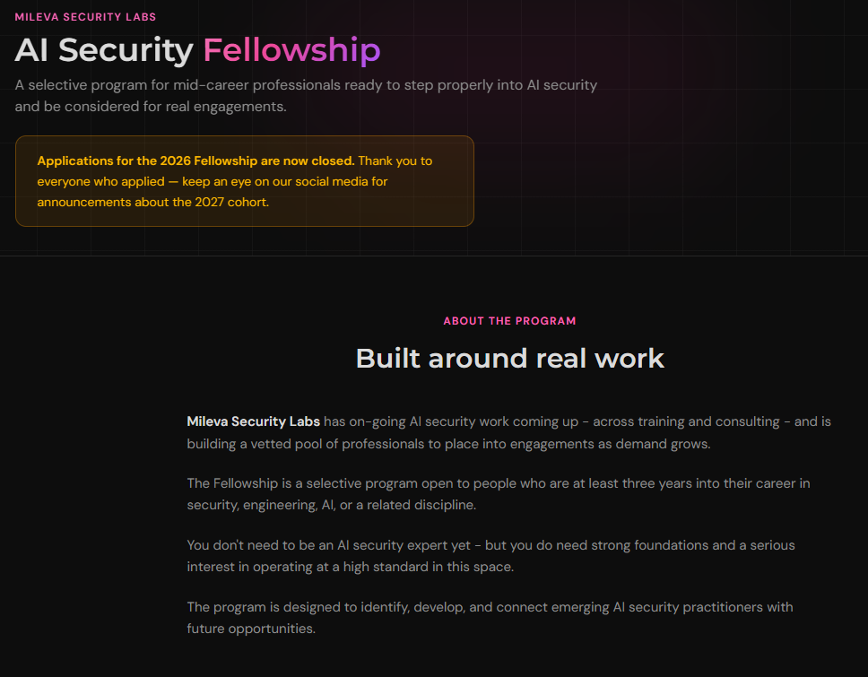

*[English version](/blog/2026/08/04/AI-Security-Fellowship-Mileva)*

<i>L'AI Security Fellowship est un programme sélectif conçu par Mileva Security Labs pour les professionnels en milieu de carrière qui souhaitent s'engager pleinement dans la sécurité de l'IA et être sollicités pour de véritables missions.  
Il est ouvert aux personnes justifiant d'au moins trois ans d'expérience en sécurité, en ingénierie, en IA ou dans une discipline proche.  
Mileva Security Labs intervient en sécurité de l'IA, aussi bien en formation qu'en conseil, et s'appuie sur ce programme pour constituer un vivier de praticiens qualifiés en vue de ses futures missions.

À l'origine du programme, on trouve Dr Harriet Farlow, fondatrice de Mileva Security Labs et autrice de <em>Practical AI Security</em>.  
Pendant huit semaines, le programme réunit le cours AI Security Fundamentals, des sessions hebdomadaires en direct, des séminaires, des permanences animées par des facilitateurs, des labs pratiques et un projet de fin de parcours.

J'ai rejoint la cohorte de juin et juillet 2026.  
Je suivais le travail d'Harriet depuis un certain temps et je souhaitais évaluer où j'en étais en sécurité de l'IA.  
Dans cet article, je reviens sur ce que j'en retire.</i>

{:refdef: style="text-align: center;"}
{: width="500" }
*L'AI Security Fellowship de Mileva Security Labs*
{: refdef}

# Le programme : de la modélisation des menaces à la gouvernance

Chaque semaine était consacrée à un thème, avec des modules de cours, un quiz et une vidéo d'Harriet réservée aux participants du programme.

La première semaine portait sur les menaces et leur modélisation.  
Tout partait d'une question : que cherche-t-on vraiment à sécuriser, le modèle ou l'ensemble du système qui l'entoure ?  
Nous avons ensuite cartographié la surface d'attaque d'un système d'IA, de ses actifs à ses points d'entrée jusqu'aux scénarios d'abus, en nous appuyant sur MITRE ATLAS et sur le Top 10 OWASP dédié aux applications LLM.

La deuxième semaine était consacrée aux fondamentaux du machine learning : ce qu'est concrètement un modèle, les mathématiques sur lesquelles il repose et l'influence des données sur son comportement, qu'il s'agisse de biais, de fuites ou d'empoisonnement.  
Comprendre comment un modèle apprend permet de comprendre comment il peut défaillir.

La troisième semaine nous a fait passer des modèles aux systèmes.  
Nous avons étudié la génération augmentée par récupération (RAG), qui consiste à ajouter des documents au contexte du modèle au moment où la requête est traitée.  
Nous avons également abordé l'orchestration, les outils et les actions, le contrôle d'accès, la journalisation et la mémoire, les garde-fous, ainsi que les situations où la présence d'un humain dans la boucle apporte réellement quelque chose, et celles où elle ne suffit pas.

La quatrième semaine était dédiée aux attaques et aux défenses : évasion, empoisonnement des données et portes dérobées, risques dissimulés dans les fichiers de modèles, inférence d'appartenance (qui permet de déterminer si une donnée a servi à l'entraînement), injection de prompt et attaques sur la chaîne d'approvisionnement.  
Des études de cas comme EchoLeak dans Microsoft 365 Copilot, les modèles malveillants publiés sur Hugging Face ou les serveurs MCP malveillants permettaient de voir chaque attaque à l'œuvre.

La cinquième semaine a remis les contrôles de cybersécurité classiques au premier plan : zero trust, gestion des identités, moindre privilège, gestion des secrets, provenance des données, MLSecOps, journalisation et réponse à incident, le tout mis en correspondance avec les référentiels existants.

La sixième semaine abordait la sûreté de l'IA : l'alignement, la mauvaise généralisation des objectifs, l'autonomie et l'usage d'outils, les évaluations et leurs limites, ainsi que le red teaming face aux risques que l'on ne connaît pas encore.

La septième semaine traitait de la gouvernance : les référentiels de gestion des risques comme ceux du NIST et de l'ISO, l'identification des systèmes à haut risque, les model cards et system cards, le risque lié aux fournisseurs et la supervision humaine dans la pratique.

Enfin, la huitième semaine visait à mettre l'ensemble en pratique : présenter les enjeux de sécurité de l'IA à une organisation et à des interlocuteurs non techniques, bâtir un premier programme de sécurité de l'IA et savoir quelles questions poser sur le terrain.

Chaque semaine, les vidéos d'Harriet présentaient le thème du point de vue d'une praticienne.  
Ce que j'ai particulièrement apprécié, c'est qu'elle partageait systématiquement plusieurs ressources et articles de recherche, qui méritaient tous d'être lus.  
Lors de la cinquième semaine, par exemple, elle s'est appuyée sur l'exemple d'un ver IA capable de se répliquer pour illustrer la différence entre une attaque, une défense, une mesure d'atténuation et un contrôle.

# Le programme en pratique : labs, séminaires et communauté

Les labs se déroulaient sur CoCalc, un environnement partagé dans lequel nous pouvions exécuter du code directement.  
Construits autour de Vroomi, un assistant IA interne fictif, ils nous permettaient d'expérimenter concrètement les vulnérabilités étudiées dans le cours.

Les sessions en direct nous donnaient l'occasion de poser nos questions, de présenter nos travaux et d'échanger sur des problématiques précises de sécurité de l'IA.  
Les permanences, animées par les facilitateurs et parfois par Harriet elle-même, offraient un espace supplémentaire pour approfondir.

Les séminaires accueillaient des intervenants extérieurs.  
Mon préféré a été celui de la sixième semaine, consacré aux puissances moyennes et présenté par Chiara Gerosa [RÔLE/ORGANISATION À CONFIRMER].  
Sa dimension géopolitique m'a passionnée, et il m'a aidée à cartographier l'écosystème de la sécurité de l'IA à l'échelle mondiale.

Le programme s'est conclu par un projet de fin de parcours : une évaluation de sécurité de Vroomi, menée avant une évolution envisagée vers un fonctionnement plus agentique et autonome.  
Ce travail combinait une revue de conception, une modélisation des menaces et des tests pratiques d'attaque et de défense.

Cet exercice m'a confortée dans une distinction que je garde toujours en tête : certaines faiblesses dépendent du modèle, mais beaucoup se situent dans le code qui l'entoure.  
Sécuriser l'IA commence par sécuriser le système.

Tous les participants ont partagé publiquement leur projet, ce qui nous a permis de nous inspirer des approches des uns et des autres.

# Ce que je retiens

Ce programme a d'abord répondu à la question que je me posais en arrivant.  
Je disposais déjà de bases solides, principalement grâce à mon expérience en sécurité offensive et à ce que j'avais appris en sécurité de l'IA auparavant, notamment à travers la certification [AI Red Teaming Professional (AIRTP+)](https://learnprompting.org/certificates/ai-red-teaming-professional-certification) de Learn Prompting.  
Ce que le programme m'a apporté en plus, c'est une structure et une méthodologie.

Le sujet que je souhaitais le plus approfondir était celui des mesures d'atténuation.  
Les systèmes d'IA sont probabilistes : une même entrée peut produire des résultats différents.  
Le fait qu'une mesure fonctionne lors d'un test ne garantit donc pas qu'elle fonctionnera lors du suivant, ce qui rend les mesures d'atténuation plus délicates à mettre en place que pour des systèmes déterministes.  
C'est précisément pour cette raison que les contrôles classiques, comme le moindre privilège, la journalisation et la validation humaine, restent indispensables.

Si je devais formuler une suggestion, ce serait de vulgariser davantage certains concepts plus complexes, en particulier pour les participants qui ne viennent pas du machine learning.  
Cela n'enlève rien à la qualité de l'expérience, et j'ai été très heureuse d'être sélectionnée.

Enfin, il y a les personnes.  
La cohorte réunissait des professionnels du monde entier, et le serveur Discord a vraiment été un atout.  
Entre les échanges, les projets partagés et les sessions en direct, l'apprentissage s'est prolongé bien au-delà des modules de cours.

Les candidatures pour l'édition 2026 sont désormais closes, mais vous pouvez suivre [Mileva Security Labs](https://aisecurityfundamentals.com/fellowship) pour être informés de l'ouverture de la cohorte 2027.
