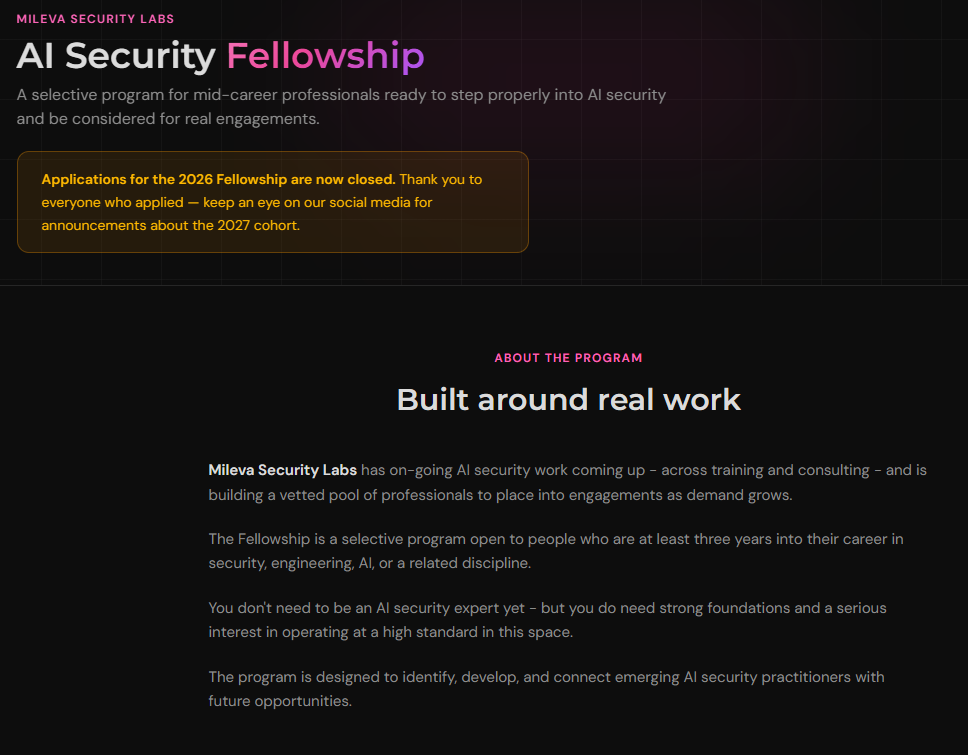

*[Version française](/blog/2026/08/04/AI-Security-Fellowship-Mileva-FR)*

<i>The AI Security Fellowship is a selective program by Mileva Security Labs for mid-career professionals ready to step properly into AI security and be considered for real engagements.  
It is open to people who are at least three years into their career in security, engineering, AI, or a related discipline.  
Mileva Security Labs works on AI security across training and consulting, and the fellowship is how it builds a vetted pool of practitioners for future engagements.</i>

<i>Dr Harriet Farlow, founder of Mileva Security Labs and author of <em>Practical AI Security</em>, is behind the program.  
Over 8 weeks, it combines the AI Security Fundamentals course, weekly live sessions, seminars, office hours with facilitators, hands-on labs, and a capstone.</i>

<i>I joined the June–July 2026 cohort.  
I had been following Harriet's work for a while, and I wanted to assess where I stood in AI security.  
In this blog, I'll share what I took away.</i>

{:refdef: style="text-align: center;"}
{: width="800" }  

*L'AI Security Fellowship de Mileva Security Labs*
{: refdef}

# The program: From Threat Models to Governance

Each week had its own theme, with course modules, a quiz, and a fellowship video from Harriet.

Week 1 started with threats and threat modelling.  
The first question was what we are actually securing: the model, or the whole system around it.  
We mapped the AI attack surface, from assets to entry points to abuse paths, and used MITRE ATLAS and the OWASP Top 10 for LLM Applications to structure the analysis.

Week 2 covered the core machine learning concepts: what a model actually is, the maths behind it, and how data issues such as bias, leakage, and poisoning shape its behaviour.  
Understanding how a model learns is what makes it possible to understand how it fails.

Week 3 moved from models to systems.  
We looked at retrieval-augmented generation (RAG): pulling documents into the model's context at runtime.  
We also covered orchestration, tools and actions, access control, logging and memory, guardrails, and when a human in the loop helps or doesn't.

Week 4 focused on attacks and defenses: evasion, data poisoning and backdoors, risks hidden in model files, membership inference (guessing whether a record was part of the training data), prompt injection, and supply chain attacks.  
Case studies such as EchoLeak in Microsoft 365 Copilot, malicious models on Hugging Face, and rogue MCP servers made each attack concrete.

Week 5 brought classical cyber controls back into the picture: zero trust, identity, least privilege, secrets management, data provenance, MLSecOps, logging, and incident response, all mapped to existing frameworks.

Week 6 was about AI safety: alignment, goal misgeneralisation, autonomy and tool use, evaluations and why they fail, and red teaming for unknown unknowns.

Week 7 covered governance: risk management frameworks such as NIST and ISO, identifying high-risk systems, model and system cards, vendor risk, and human oversight in practice.

Week 8 put it all into practice: how to communicate AI security to an organisation and to non-technical stakeholders, how to build a first AI security program, and which questions to ask in real environments.

Harriet's weekly videos explained the topic of the week from a practitioner's point of view.  
What I liked most is that she always shared several resources and research papers, and they were always worth reading.  
In week 5, for example, she used a self-replicating AI worm to show the difference between an attack, a defense, a mitigation, and a control.

# The fellowship: Labs, Seminars and Community

The labs ran in CoCalc, a shared environment where we could run code directly.  
They were built around Vroomi, a fictional internal AI assistant, and gave us the opportunity to experiment with the vulnerabilities covered in the course.

During the live sessions, we could ask questions, share our work, and discuss specific AI security issues.  
Office hours with the facilitators, and sometimes with Harriet, added another space to go deeper.

The seminars brought in guest speakers.  
My favorite was the week 6 seminar on middle powers by Chiara Gerosa [ROLE/ORGANIZATION TO CONFIRM].  
It was really interesting in terms of geopolitics, and it helped me map the AI security ecosystem around the world.

The program ended with a capstone: an AI security assessment of Vroomi, before a proposed expansion into more agentic, autonomous behaviour.  
It combined a design review, threat modelling, and hands-on attack and defense testing.

This exercise reinforced a distinction I keep in mind: some weaknesses depend on the model, but many live in the code around it.  
Securing AI starts with securing the system.

Everyone in the cohort shared their capstone publicly, so we could learn from each other's approaches.

# What I'm Taking Home

The first thing the fellowship gave me is the answer I came for.  
I already had strong foundations, mostly thanks to my experience in offensive security and to what I had learned about AI security before, including the [AI Red Teaming Professional Certification (AIRTP+)](https://learnprompting.org/certificates/ai-red-teaming-professional-certification) by Learn Prompting.  
What the fellowship brought is structure and methodology.

The topic I wanted to explore most was mitigations.  
AI systems are probabilistic: the same input can produce different outputs.  
A mitigation that works on one test is not proof that it will hold on the next one, which makes mitigations more complex than with deterministic systems.  
This is exactly why classical controls such as least privilege, logging, and human validation remain essential.

If I had one suggestion, it would be to simplify some of the more complex concepts a little further, especially for fellows coming from outside machine learning.  
It takes nothing away from an excellent experience, and I was really happy to be selected.

Finally, the people.  
The cohort brought together professionals from all over the world, and the Discord was definitely a plus.  
Between the discussions, the shared capstones, and the live sessions, the learning continued well beyond the course modules.

Applications for the 2026 fellowship are now closed, but you can follow [Mileva Security Labs](https://aisecurityfundamentals.com/fellowship) for announcements about the 2027 cohort.
